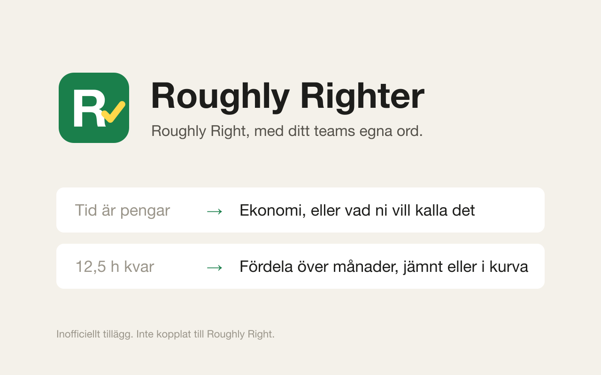

# Roughly Righter

Chrome-tillägg som låter dig ge texter i Roughly Right egna namn.
Kör bara på `app.roughlyright.com` och fungerar både i webbläsarfliken och i den
installerade Chrome-appen.

## Installera

1. Ladda ner mappen: `git clone https://github.com/WeAreHausTech/roughly-righter.git`,
   eller ladda ner den som zip från https://github.com/WeAreHausTech/roughly-righter och packa upp.
2. Öppna `chrome://extensions` i Chrome.
3. Slå på **Developer mode** uppe till höger.
4. Klicka **Load unpacked** och välj mappen `roughly-righter` (`roughly-righter-main` om du laddade ner zip).
5. Ladda om Roughly Right med Cmd+R.

Mappen måste ligga kvar. Chrome läser den varje gång webbläsaren startar.

## Ändra texter

Klicka på tilläggets ikon i Chrome, så öppnas inställningssidan. En regel per rad:

```
Gammal text => Ny text
```

Texten måste matcha exakt, även stora och små bokstäver. Det är med flit, så att
projekt- och kundnamn inte byts av misstag. Nya regler slår igenom direkt. Om du
tar bort en regel behöver appen laddas om.

Reglerna sparas per Chrome-profil och synkas via ditt Google-konto. Standard-
reglerna i `rules-default.txt` används bara så länge du inte sparat egna.

## Standardregler

| Nu | Blir |
|---|---|
| Vad har jag gjort? | Tidsrapportering |
| Roughly Now | Översikt |
| Pågående | Projekt |
| Arkivet | Register |
| Tid är pengar | Ekonomi |
| Återhämtningsgrad | Debiteringsgrad |
| Eff. timarvode | Snittpris/timme |
| View.Changes | Visa ändringar |
| YEAR_TO_DATE | Hittills i år |
| Download as excel | Exportera till Excel |
| Download | Ladda ner |
| Previous | Föregående |
| Next | Nästa |

## Flytta Kvar till månader

Under Pågående, klicka på ett belopp i kolumnen **Kvar**. Menyn har två lägen:

1. **En månad** (standard): de fyra första öppna månaderna, även de utanför vyn,
   med nuvarande värde och värdet efter flytten. Klicka på en månad så sparas det.
2. **Fördela**: sprid beloppet över 1–12 öppna månader. Välj antal med − och +,
   och form med Jämnt, Framtungt, Baktungt eller Egen (normalfördelning).
   Med Egen styr reglaget Topp vilken månad toppen hamnar i.
   Skriv ett belopp eller en procentsats (t.ex. `30%`) i en månad så låses den
   (🔒), och resten fördelas på de olåsta månaderna enligt vald form. Det blir
   aldrig något kvar. Minst en månad är alltid olåst: låser du den sista släpps
   den du låste först. Klicka på 🔒 eller "Lås upp alla" för att släppa låsen.

Stängda månader hoppas över. Belopp avrundas till hela kronor och
avrundningsresten hamnar på sista månaden.

## Utveckling

Kör `npm install` en gång. Det installerar Playwright, som bara behövs för att testa
tillägget. Chrome läser inte `node_modules/`, och `build.sh` packar bara tilläggets egna filer.

1. `npm run browser` öppnar Roughly Right i ett eget Chromium-fönster med tillägget laddat
   från den här mappen. Logga in en gång. Inloggningen sparas i `.playwright-profile/`, som
   inte checkas in.
2. `npm run check` startar Chromium utan fönster. Playwright svarar med en testsida i stället
   för den riktiga sidan på `app.roughlyright.com`, och skriptet kontrollerar att tillägget
   byter texterna och att inställningssidan visar standardreglerna. Kommandot slutar med en
   felkod om någon kontroll misslyckas.

Claude Code startar `npm run browser` från `.claude/launch.json`. Förhandsvisningen i Claude
visar då en statussida på port 9333, och tillägget körs i Chromium-fönstret.

## Så fungerar det

`content.js` läser reglerna, går igenom sidans texter och byter de som matchar.
En MutationObserver fångar upp nytt innehåll, eftersom Roughly Right renderar om
delar av sidan hela tiden. Förutom synlig text byts även platshållare,
hovringstexter, aria-etiketter och fönstrets titel.

`kvar.js` står för Kvar-menyn. Den körs i sidans egen JS-värld för att kunna
läsa projektets månadsfördelning, och sparar via samma API-anrop som appen
(`projects.updateSubDocument` eller `projects.addSubDocument`). Därefter laddas
listan om.
